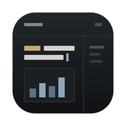
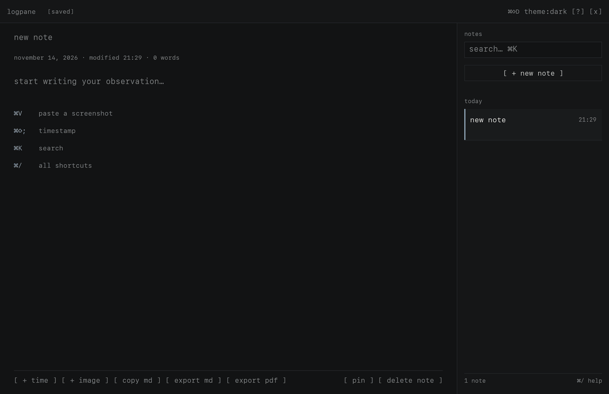
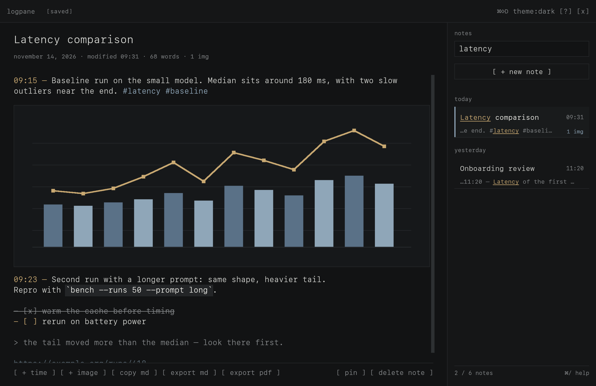
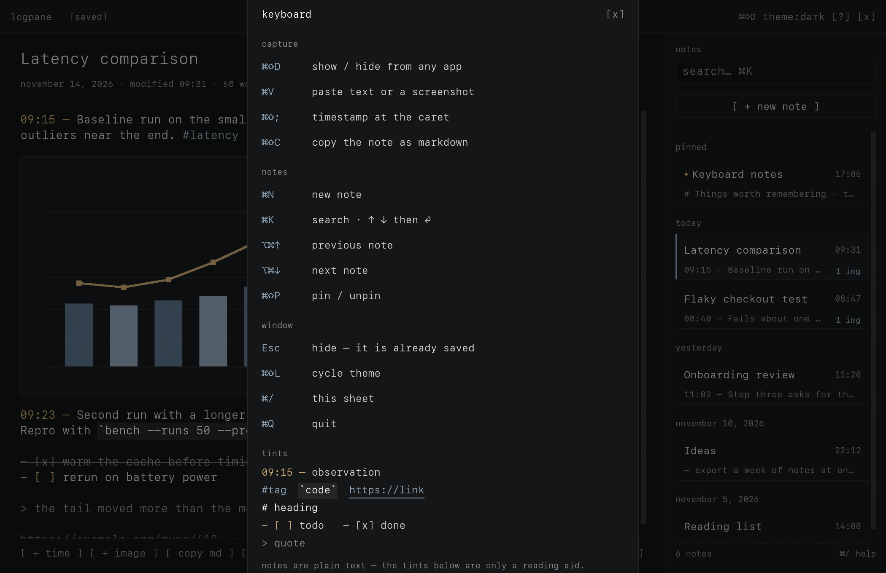
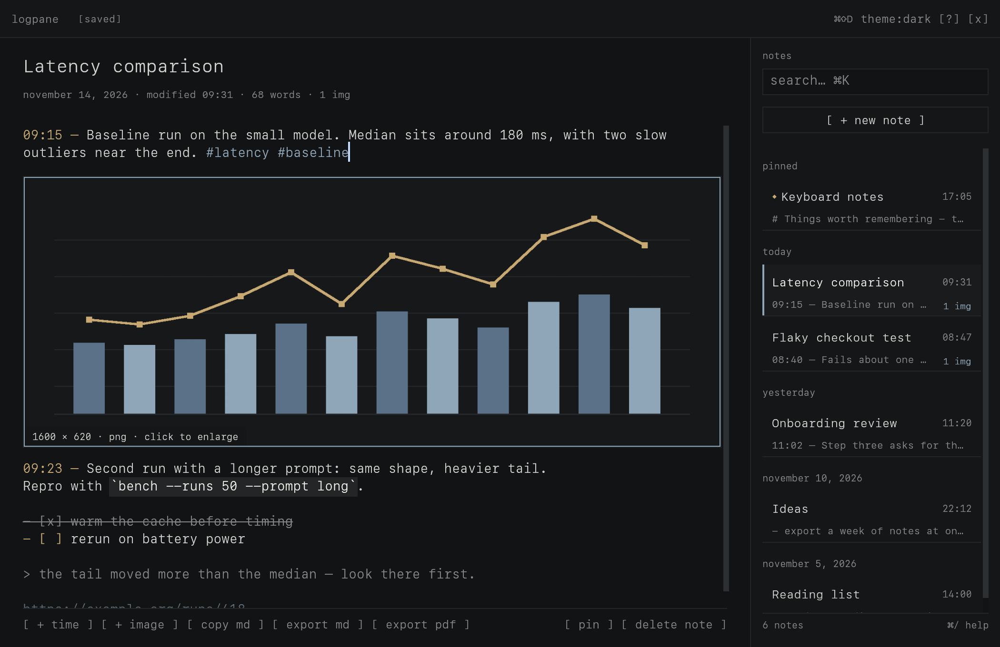
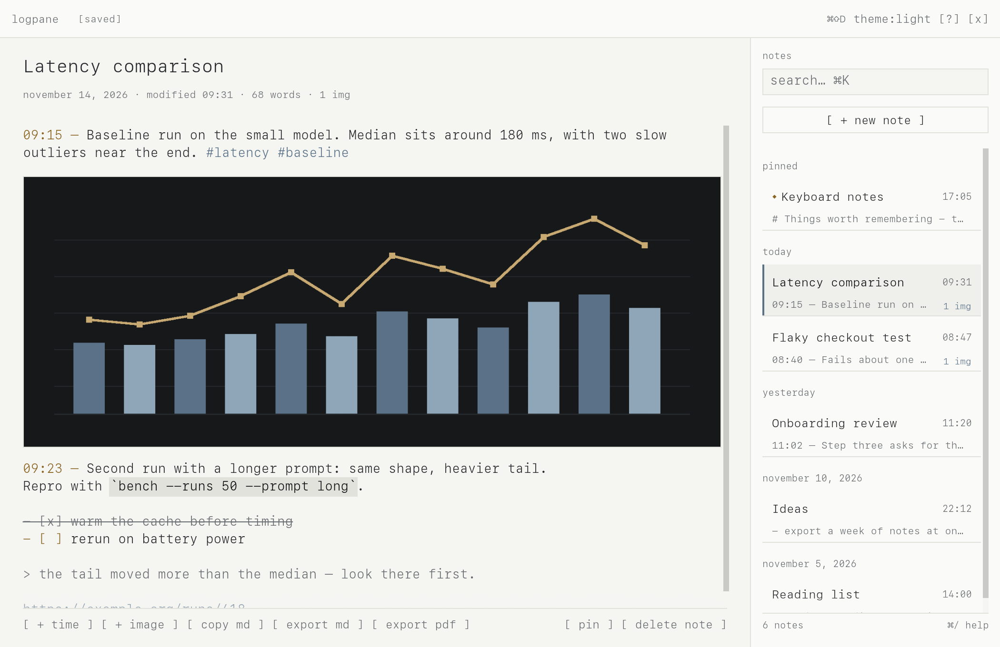

<p align="center">
  
</p>

<h1 align="center">Logpane</h1>

<p align="center">
  <strong>Capture observations at the speed of thought.</strong><br>
  A resident macOS overlay: one shortcut, type, paste a screenshot, <code>Esc</code>. It is already saved.
</p>

<p align="center">
  <a href="https://github.com/lucydjo/Logpane/releases/latest"></a>
  <a href="https://github.com/lucydjo/Logpane/actions/workflows/ci.yml"></a>
  
  
  
  
</p>

<p align="center">
  
</p>

<p align="center"><code>⌘⇧D → type → ⌘V → Esc</code></p>

<table>
<tr>
<td width="33%" valign="top"><strong>10 MB, no runtime</strong><br>Rust + egui with a thin AppKit bridge. No Electron, no WebView, no helper process.</td>
<td width="33%" valign="top"><strong>Zero network</strong><br>No account, no telemetry, no sockets. Notes live in one SQLite file you can copy.</td>
<td width="33%" valign="top"><strong>Nothing to manage</strong><br>No project, no file name, no Save button. Plain text in, Markdown or PDF out.</td>
</tr>
</table>

---

**Contents** · [Why](#why-logpane) · [Features](#features) · [Install](#install) ·
[Usage](#usage) · [Themes](#themes) · [How it works](#how-it-works) ·
[Your data](#your-data) · [Status](#status) · [Troubleshooting](#troubleshooting) ·
[Development](#development) · [Contributing](#contributing) · [License](#license)

## Why Logpane

Testing a model, comparing two tools, chasing a bug: the interesting part appears for a few
seconds and disappears as soon as you switch context. Opening a notes app, choosing a folder and
naming a file is enough to lose it.

Logpane is built around one gesture:

- **It is already running.** The process stays resident; showing the overlay is a window toggle,
  not an application launch.
- **The caret is already there.** No empty state to dismiss, no template to pick.
- **The screenshot is already content.** Paste or drop an image and it becomes a block in the
  document — not a path, not a Markdown link, not a file in `/tmp`.
- **The note is already saved.** Every real change goes through a write queue and is flushed
  before the overlay hides, before switching notes and before quitting.

## Features

| Capture | Find | Keep |
|---|---|---|
| Global `⌘⇧D` toggle from any app | `⌘K` search over titles and text | SQLite (WAL), serialized writer thread |
| Images from the clipboard (`⌘V`) | Matches highlighted, excerpt moved to the hit | Automatic save, flush before hide/quit |
| Drag and drop from Finder or a capture tool | `↑` `↓` `⏎` to open without the mouse | SHA-256 content-addressed images |
| `⌘⇧;` timestamp at the caret | `⌥⌘↑` / `⌥⌘↓` previous / next note | Images survive source deletion |
| Timestamps, `#tags`, `` `code` ``, links, todos tinted as you type | Pinned notes stay on top (`⌘⇧P`) | Markdown export with an assets folder |
| Undo for a removed image | Notes grouped by day | PDF export with a real text layer |
| `⌘⇧C` copies the note as Markdown | Word and image counts | Restored note, theme and geometry |

<p align="center">
  
  
</p>

- **Plain text, tinted.** Notes are stored exactly as typed. A leading `09:15 —`, `#tags`,
  `` `code` ``, links, `# headings`, `> quotes` and `- [ ]` / `- [x]` tasks are coloured as a
  reading aid; nothing is hidden or rewritten.
- **Terminal-like by design.** SF Mono everywhere, square corners, 1 px rules, low-contrast
  surfaces and one spacing scale. It looks like a tool, not a dashboard.
- **Native, not wrapped.** Rust + egui/eframe, with a small AppKit bridge for the floating window,
  the pasteboard and the menu-bar item. No Electron, no Tauri, no WebView.
- **Local by default.** No account, no analytics, no telemetry, no network access. No
  Accessibility or Screen Recording permission is requested.
- **Exportable.** `[ export pdf ]` writes an A4 PDF with selectable, extractable text and the
  note images, so the note can be read by a person, a search engine or an LLM.
- **Boring where it matters.** Parameterised SQL, content-addressed files, a single-instance lock,
  bounded image imports and explicit save errors.

## Install

### Requirements

| Requirement | Detail |
|---|---|
| OS | macOS 12 or later |
| Hardware | Apple Silicon (M1–M4; M2 is the reference target) |
| Toolchain | Rust 1.95+ — `rust-toolchain.toml` pins 1.99.1 |
| Xcode | Command-line tools (`xcode-select --install`) |

Intel Macs are not supported. No Node, Homebrew formula or external service is required.

### Download

Grab the `.dmg` from the [latest release](https://github.com/lucydjo/Logpane/releases/latest),
drag **Logpane** to Applications, then remove the quarantine flag once:

```bash
xattr -dr com.apple.quarantine /Applications/Logpane.app
```

The build is **ad-hoc signed, not notarised** (there is no Developer ID yet), so Gatekeeper
blocks it until that flag is removed. Each release lists SHA-256 sums; if you would rather not
trust a binary, build it yourself — it takes about a minute.

### From source

```bash
git clone https://github.com/lucydjo/Logpane.git
cd Logpane
cargo run                 # starts hidden; press ⌘⇧D
cargo run -- --show       # development: show the window immediately
```

Build a local `.app`:

```bash
./scripts/build-app.sh            # Logpane.app
./scripts/build-app.sh --dist     # also dist/Logpane-<version>-arm64.{dmg,zip}
open Logpane.app
```

### Verify the build

```bash
cargo test --locked       # 100 tests: model, tints, search, assets, persistence, exports, migrations
cargo clippy --all-targets -- -D warnings
cargo fmt --all -- --check
./target/debug/logpane --smoke-test
# smoke test ok: storage=… notes=1
```

## Usage

Press `⌘⇧D` from any application. The overlay appears above the current window with the caret in
the active note. Press the shortcut again, `Esc`, `⌘W` or `[x]` to hide it.

```text
⌘⇧D        show / hide the overlay
⌘N         new note
⌘K         search — ↑ ↓ to move, ⏎ to open, Esc to leave
⌥⌘↑ / ⌥⌘↓  previous / next note
⌘⇧P        pin / unpin the note
⌘⇧;        insert HH:mm — at the caret
⌘V         paste text, or import an image from the clipboard
⌘⇧C        copy the note as Markdown
⌘Z / ⌘⇧Z   undo / redo text
⌘⇧L        cycle theme
⌘/         shortcut sheet
⌘Q         quit (or use the menu-bar icon → Quit Logpane)
```

### Images

Paste a screenshot with `⌘V`, or drag one or more files onto the editor. Logpane reads the bytes
immediately, copies them into its own asset store, computes a SHA-256, renders a thumbnail and
inserts a real image block at the caret. The source file can then be deleted; the note keeps the
image.

Pasting an image only happens when a text block has focus. Pasting into the title or the search
field keeps normal text behaviour. When the clipboard holds both text and a picture, as it does
after copying spreadsheet cells, the text is pasted; if that text is only the address of the
image, the picture is imported.

### Export

- `[ export md ]` writes `<title>.md` and copies the note images into `<title>.assets/` next to
  it. The body is your text, unchanged; images become ordinary `` links.
- `⌘⇧C` / `[ copy md ]` puts the same Markdown on the clipboard, with image links pointing into
  the local asset store — handy for pasting into an issue draft, an editor or an LLM.
- `[ export pdf ]` writes an A4 PDF. Text stays as text (selectable and extractable), images are
  embedded without JPEG artifacts, and the reading order follows the document. The PDF is
  readable by `pdftotext` and LLM ingestion tools; metadata carries the title, author and dates.

### Notes

The sidebar lists notes by last modification, grouped by day, with pinned notes on top. `⌘K`
filters on titles and body text, ignoring case and common Latin accents; the match is highlighted
and the excerpt moves to it. Right-click a note to pin or delete it. Deleting a note asks for confirmation; deleting the last note
leaves a blank one so the editor always has a document.

## Themes

The theme control in the header cycles `system → dark → light` and is remembered across launches.
The first run follows the macOS appearance.

<p align="center">
  
  
</p>

## How it works

```text
             ⌘⇧D
 any app ─────────▶ egui overlay (resident process)
          ◀─────────
             Esc
                  │
        ┌─────────┴──────────┐
        ▼                    ▼
  SQLite writer         asset worker
  WAL · one thread      decode · SHA-256 · thumbnail
        │                    │
        ▼                    ▼
  logpane.sqlite       assets/<sha256>.<ext>
```

A few invariants hold the design together:

1. **Images are content, never paths.** Bytes are copied into `assets/` and referenced by hash.
2. **Persistence is immediate.** Text changes are coalesced for 200 ms, then written by a dedicated
   thread. The queue is flushed before hide, note switch and quit; write failures are surfaced.
3. **The editor never decodes an original image.** Imports run on a bounded worker and the editor
   decodes only thumbnails, capped at 1600 × 1200. PDF export is the exception: it decodes originals
   on the UI thread, so the window can pause during a large export.
4. **One instance owns the data.** An exclusive lock on the data directory prevents two processes
   from overwriting each other's notes.
5. **`unsafe` stays contained.** All AppKit calls live in `src/platform/macos/`, and so does all
   `unsafe` except the file lock in `src/instance.rs`. The domain, storage and UI layers forbid it.

The full design record is in [`specs/001-logpane-mvp/`](specs/001-logpane-mvp/), including the
[UI contract](specs/001-logpane-mvp/contracts/ui-contract.md) and the
[manual acceptance guide](specs/001-logpane-mvp/quickstart.md).

## Your data

```text
~/Library/Application Support/io.github.lucydjo.logpane/
├── logpane.sqlite            # notes, assets, preferences (WAL)
└── assets/
    ├── <sha256>.<ext>         # imported originals
    └── thumbnails/<sha256>.png
```

The directory is created with `0700` permissions; the database and assets use `0600`.
`LOGPANE_DATA_DIR=/some/path` selects another folder for development or demos. To reset the app,
quit it and delete the folder.

> **Privacy.** Logpane makes no network requests, has no account and collects no analytics. It
> reads only the clipboard and files you explicitly paste or drop. Diagnostics go to stderr when
> launched from a terminal (`RUST_LOG=logpane=debug`) and never contain note text or image data.

## Status

**Alpha.** The domain, storage, export and image layers are covered by 100 automated tests, and the app has
been validated by hand on a real Apple Silicon Mac; [`TODO.md`](TODO.md) lists every check.

Not there yet:

- `⌘Z` undoes text only. A removed image has its own `[ undo ]`; an inserted one does not.
- HEIC/HEIF is not decoded (PNG, JPEG, TIFF and WebP are).
- The enlarged preview uses the thumbnail, not the original.
- No notarised build: releases are ad-hoc signed and need the quarantine flag removed.
- No ZIP backup, no cloud sync, no configurable shortcut.
- No auto-hide on deactivation and no “pin” mode.
- Full keyboard traversal and VoiceOver coverage are incomplete.
- Emoji are kept in the note but not displayed, and PDF exports show them as `□`.
- In PDF exports, Arabic letters are not joined.

## Troubleshooting

- **`⌘⇧D` does nothing.** Another app may use the same shortcut, and macOS does not report this
  conflict to Logpane. The shortcut is not configurable yet: quit the other app or use the menu-bar
  icon to show the window. `⌘⇧J` is used only if macOS refuses `⌘⇧D`, and the header then shows it.
- **The window is hidden or off-screen.** Menu-bar icon → “Show Logpane”. Geometry is clamped to
  the visible screen on launch.
- **The menu-bar icon is hidden by the notch or a crowded menu bar.** Press `⌘Q` while the
  overlay is focused, or run `pkill -f "Logpane.app/Contents/MacOS/Logpane"`.
- **The app refuses to start after a downgrade.** A database written by a newer version is
  refused rather than modified; upgrade Logpane or restore the data folder.
- **The build fails on an older Rust.** Use the pinned toolchain (`rustup show`) and Rust 1.95+.
- **An image is rejected.** Imports are capped at 40 MB, 40 MP and 12 000 px per side; convert
  very large screenshots to PNG first.

## Development

```bash
cargo fmt --all
cargo clippy --all-targets -- -D warnings
cargo test --locked
cargo run -- --show
```

```text
src/
├── main.rs              bootstrap, global shortcut, launch, startup errors
├── app.rs               state machine, shortcuts, autosave, worker events
├── shortcuts.rs         key labels, global codes and local detection
├── strings.rs           English UI strings
├── fsutil.rs            private-by-default permissions
├── core/                pure domain: models, note service, autosave, search, tints, assets
├── storage/             SQLite schema, migrations, writer thread
├── ui/                  egui shell, header, editor, sidebar, themes, widgets
├── export/              Markdown and PDF export
└── platform/macos/      window, hotkey, pasteboard, menu bar, save panel, alerts
```

`./scripts/screenshots.sh` regenerates every image of this page from synthetic notes
(`examples/seed_demo.rs`); `./scripts/build-icon.sh` rebuilds the icon from `resources/icon.svg`.
Pushing a `v*` tag runs [`release.yml`](.github/workflows/release.yml), which packages the app
and publishes the release.

CI runs `fmt`, `clippy -D warnings`, `test --locked` and a release build on macOS
([`.github/workflows/ci.yml`](.github/workflows/ci.yml)). The project is macOS-only; other
platforms are not supported.

More documents:

- [Contributing](CONTRIBUTING.md)
- [Code of conduct](CODE_OF_CONDUCT.md)
- [Security policy](SECURITY.md)
- [Changelog](CHANGELOG.md)
- [Governance](docs/constitution.md)
- [Third-party notices](THIRD_PARTY_NOTICES.md)

## Contributing

Bug reports and focused pull requests are welcome. Read [`CONTRIBUTING.md`](CONTRIBUTING.md)
first; for a change larger than a fix, open an issue so the scope can be agreed. Security issues
should go through the private advisory channel described in [`SECURITY.md`](SECURITY.md).

The project deliberately has no network access, no telemetry and no WebView. Please keep it that
way.

## License

[MIT](LICENSE) © Logpane contributors.

Third-party crates, SQLite and the fonts used at runtime are documented in
[`THIRD_PARTY_NOTICES.md`](THIRD_PARTY_NOTICES.md).
