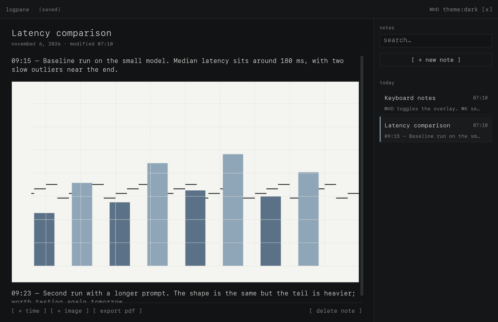
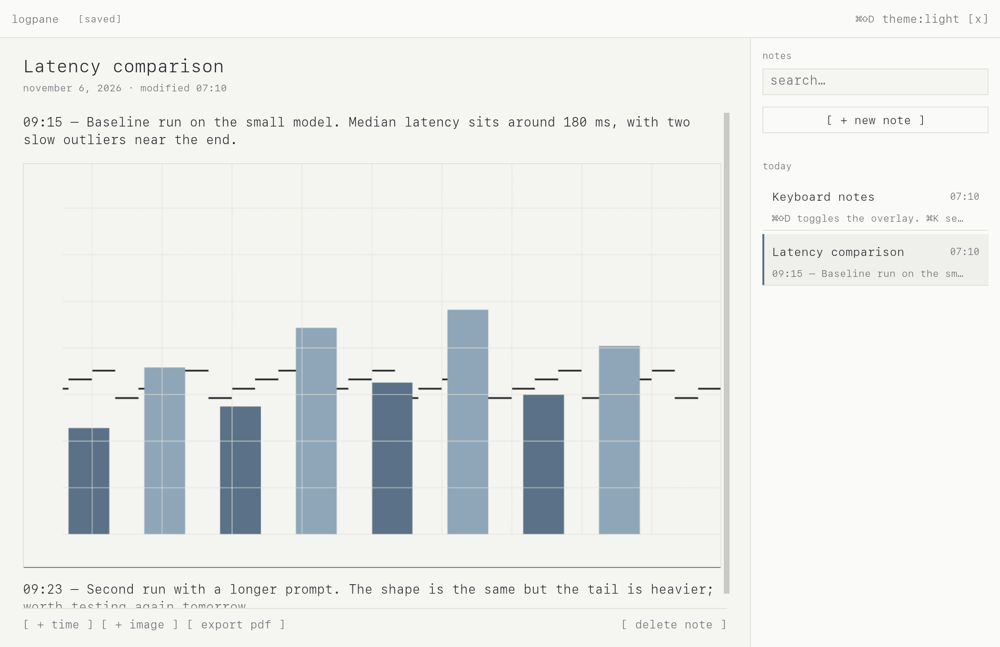

<h1 align="center">Logpane</h1>

<p align="center">
  <strong>Capture observations at the speed of thought.</strong>
</p>

<p align="center">
  
  
  
  
  
</p>

A resident macOS overlay for the moment something worth remembering happens. Press `⌘⇧D`, type
the observation, paste or drop a screenshot, press `Esc` — it is already saved. No project to
create, no file to name, no Save button.

<p align="center">
  
</p>

<p align="center"><code>⌘⇧D → type → ⌘V → Esc</code></p>

---

**Contents** · [Why](#why-logpane) · [Features](#features) · [Install](#install) ·
[Usage](#usage) · [Themes](#themes) · [How it works](#how-it-works) ·
[Your data](#your-data) · [Status](#status) · [Troubleshooting](#troubleshooting) ·
[Development](#development) · [Contributing](#contributing) · [License](#license)

## Why Logpane

Testing a model, comparing two tools, chasing a bug: the interesting part appears for a few
seconds and disappears as soon as you switch context. Opening a notes app, choosing a folder and
naming a file is enough to lose it.

Logpane is built around one gesture:

- **It is already running.** The process stays resident; showing the overlay is a window toggle,
  not an application launch.
- **The caret is already there.** No empty state to dismiss, no template to pick.
- **The screenshot is already content.** Paste or drop an image and it becomes a block in the
  document — not a path, not a Markdown link, not a file in `/tmp`.
- **The note is already saved.** Every real change goes through a write queue and is flushed
  before the overlay hides, before switching notes and before quitting.

## Features

| Capture | Keep |
|---|---|
| Global `⌘⇧D` toggle from any app | SQLite (WAL) with a serialized writer thread |
| Multiline editor with real text selection | Automatic save, flush before hide/quit |
| Images from the clipboard (`⌘V`) | SHA-256 content-addressed assets |
| Drag and drop from Finder or a capture tool | Atomic writes, thumbnails, deduplication |
| Temporary paths and `file://` URLs | Images survive restart and source deletion |
| `⌘⇧;` timestamp at the caret | Notes sorted by last modification |
| `⌘K` search over titles and text | Restored note, theme and window geometry |
| PDF export with a real text layer and images | Single-instance lock on the data directory |

- **Terminal-like by design.** SF Mono everywhere, square corners, 1 px rules, low-contrast
  surfaces and one spacing scale. It looks like a tool, not a dashboard.
- **Native, not wrapped.** Rust + egui/eframe, with a small AppKit bridge for the floating window,
  the pasteboard and the menu-bar item. No Electron, no Tauri, no WebView.
- **Local by default.** No account, no analytics, no telemetry, no network access. No
  Accessibility or Screen Recording permission is requested.
- **Exportable.** `[ export pdf ]` writes an A4 PDF with selectable, extractable text and the
  note images, so the note can be read by a person, a search engine or an LLM.
- **Boring where it matters.** Parameterised SQL, content-addressed files, a single-instance lock,
  bounded image imports and explicit save errors.

## Install

### Requirements

| Requirement | Detail |
|---|---|
| OS | macOS 12 or later |
| Hardware | Apple Silicon (M1–M4; M2 is the reference target) |
| Toolchain | Rust 1.95+ — `rust-toolchain.toml` pins 1.99.1 |
| Xcode | Command-line tools (`xcode-select --install`) |

Intel Macs are not supported. No Node, Homebrew formula or external service is required.

### From source

```bash
git clone https://github.com/lucydjo/Logpane.git
cd Logpane
cargo run                 # starts hidden; press ⌘⇧D
cargo run -- --show       # development: show the window immediately
```

Build a local `.app`:

```bash
./scripts/build-app.sh
open Logpane.app
```

The bundle is **ad-hoc signed for local use only**. There is no signed or notarised binary and no
app icon yet, so a copy downloaded from the internet will be rejected by Gatekeeper. Build it
yourself.

### Verify the build

```bash
cargo test --locked       # 84 tests: model, search, assets, persistence, PDF export, migrations
cargo clippy --all-targets -- -D warnings
cargo fmt --all -- --check
./target/debug/logpane --smoke-test
# smoke test ok: storage=… notes=1
```

## Usage

Press `⌘⇧D` from any application. The overlay appears above the current window with the caret in
the active note. Press the shortcut again, `Esc`, `⌘W` or `[x]` to hide it.

```text
⌘⇧D        show / hide the overlay
⌘N         new note
⌘K         focus search
⌘⇧;        insert HH:mm — at the caret
⌘V         paste text, or import an image from the clipboard
⌘Z / ⌘⇧Z   undo / redo text
⌘Q         quit (or use the menu-bar icon → Quit Logpane)
```

### Images

Paste a screenshot with `⌘V`, or drag one or more files onto the editor. Logpane reads the bytes
immediately, copies them into its own asset store, computes a SHA-256, renders a thumbnail and
inserts a real image block at the caret. The source file can then be deleted; the note keeps the
image.

Pasting an image only happens when a text block has focus. Pasting into the title or the search
field keeps normal text behaviour. When the clipboard holds both text and a picture, as it does
after copying spreadsheet cells, the text is pasted; if that text is only the address of the
image, the picture is imported.

### PDF export

`[ export pdf ]` in the action bar opens a native save panel and writes the current note as an
A4 PDF. Text stays as text (selectable and extractable), images are embedded without JPEG
artifacts, and the reading order follows the document. The PDF is readable by `pdftotext` and LLM
ingestion tools; metadata carries the title, author and dates.

### Notes

The sidebar lists notes by last modification, grouped by day. `⌘K` filters on titles and body
text, ignoring case and common Latin accents. Deleting a note asks for confirmation; deleting the last note
leaves a blank one so the editor always has a document.

## Themes

The theme control in the header cycles `system → dark → light` and is remembered across launches.
The first run follows the macOS appearance.

<details>
<summary>Light theme</summary>
<br>

</details>

## How it works

```text
             ⌘⇧D
 any app ─────────▶ egui overlay (resident process)
          ◀─────────
             Esc
                  │
        ┌─────────┴──────────┐
        ▼                    ▼
  SQLite writer         asset worker
  WAL · one thread      decode · SHA-256 · thumbnail
        │                    │
        ▼                    ▼
  logpane.sqlite       assets/<sha256>.<ext>
```

A few invariants hold the design together:

1. **Images are content, never paths.** Bytes are copied into `assets/` and referenced by hash.
2. **Persistence is immediate.** Text changes are coalesced for 200 ms, then written by a dedicated
   thread. The queue is flushed before hide, note switch and quit; write failures are surfaced.
3. **The editor never decodes an original image.** Imports run on a bounded worker and the editor
   decodes only thumbnails, capped at 1600 × 1200. PDF export is the exception: it decodes originals
   on the UI thread, so the window can pause during a large export.
4. **One instance owns the data.** An exclusive lock on the data directory prevents two processes
   from overwriting each other's notes.
5. **`unsafe` stays contained.** All AppKit calls live in `src/platform/macos/`, and so does all
   `unsafe` except the file lock in `src/instance.rs`. The domain, storage and UI layers forbid it.

The full design record is in [`specs/001-logpane-mvp/`](specs/001-logpane-mvp/), including the
[UI contract](specs/001-logpane-mvp/contracts/ui-contract.md) and the
[manual acceptance guide](specs/001-logpane-mvp/quickstart.md).

## Your data

```text
~/Library/Application Support/io.github.lucydjo.logpane/
├── logpane.sqlite            # notes, assets, preferences (WAL)
└── assets/
    ├── <sha256>.<ext>         # imported originals
    └── thumbnails/<sha256>.png
```

The directory is created with `0700` permissions; the database and assets use `0600`.
`LOGPANE_DATA_DIR=/some/path` selects another folder for development or demos. To reset the app,
quit it and delete the folder.

> **Privacy.** Logpane makes no network requests, has no account and collects no analytics. It
> reads only the clipboard and files you explicitly paste or drop. Diagnostics go to stderr when
> launched from a terminal (`RUST_LOG=logpane=debug`) and never contain note text or image data.

## Status

**Alpha.** The domain, storage and image layers are covered by 84 automated tests, and the app has
been validated by hand on a real Apple Silicon Mac; [`TODO.md`](TODO.md) lists every check.

Not there yet:

- `⌘Z` undoes text, not image-block insertion or removal.
- HEIC/HEIF is not decoded (PNG, JPEG, TIFF and WebP are).
- The enlarged preview uses the thumbnail, not the original.
- No signed/notarised build, no app icon.
- No Markdown or ZIP export, no cloud sync, no configurable shortcut. PDF export exists.
- No auto-hide on deactivation and no “pin” mode.
- Full keyboard traversal and VoiceOver coverage are incomplete.
- Emoji are kept in the note but not displayed, and PDF exports show them as `□`.
- In PDF exports, Arabic letters are not joined.

## Troubleshooting

- **`⌘⇧D` does nothing.** Another app may use the same shortcut, and macOS does not report this
  conflict to Logpane. The shortcut is not configurable yet: quit the other app or use the menu-bar
  icon to show the window. `⌘⇧J` is used only if macOS refuses `⌘⇧D`, and the header then shows it.
- **The window is hidden or off-screen.** Menu-bar icon → “Show Logpane”. Geometry is clamped to
  the visible screen on launch.
- **The menu-bar icon is hidden by the notch or a crowded menu bar.** Press `⌘Q` while the
  overlay is focused, or run `pkill -f "Logpane.app/Contents/MacOS/Logpane"`.
- **The app refuses to start after a downgrade.** A database written by a newer version is
  refused rather than modified; upgrade Logpane or restore the data folder.
- **The build fails on an older Rust.** Use the pinned toolchain (`rustup show`) and Rust 1.95+.
- **An image is rejected.** Imports are capped at 40 MB, 40 MP and 12 000 px per side; convert
  very large screenshots to PNG first.

## Development

```bash
cargo fmt --all
cargo clippy --all-targets -- -D warnings
cargo test --locked
cargo run -- --show
```

```text
src/
├── main.rs              bootstrap, global shortcut, launch, startup errors
├── app.rs               state machine, shortcuts, autosave, worker events
├── shortcuts.rs         key labels, global codes and local detection
├── strings.rs           English UI strings
├── fsutil.rs            private-by-default permissions
├── core/                pure domain: models, note service, autosave, search, assets
├── storage/             SQLite schema, migrations, writer thread
├── ui/                  egui shell, header, editor, sidebar, themes, widgets
├── export/              PDF export (text layer + embedded images)
└── platform/macos/      window, hotkey, pasteboard, menu bar, save panel, alerts
```

CI runs `fmt`, `clippy -D warnings`, `test --locked` and a release build on macOS
([`.github/workflows/ci.yml`](.github/workflows/ci.yml)). The project is macOS-only; other
platforms are not supported.

More documents:

- [Contributing](CONTRIBUTING.md)
- [Code of conduct](CODE_OF_CONDUCT.md)
- [Security policy](SECURITY.md)
- [Changelog](CHANGELOG.md)
- [Governance](docs/constitution.md)
- [Third-party notices](THIRD_PARTY_NOTICES.md)

## Contributing

Bug reports and focused pull requests are welcome. Read [`CONTRIBUTING.md`](CONTRIBUTING.md)
first; for a change larger than a fix, open an issue so the scope can be agreed. Security issues
should go through the private advisory channel described in [`SECURITY.md`](SECURITY.md).

The project deliberately has no network access, no telemetry and no WebView. Please keep it that
way.

## License

[MIT](LICENSE) © Logpane contributors.

Third-party crates, SQLite and the fonts used at runtime are documented in
[`THIRD_PARTY_NOTICES.md`](THIRD_PARTY_NOTICES.md).
